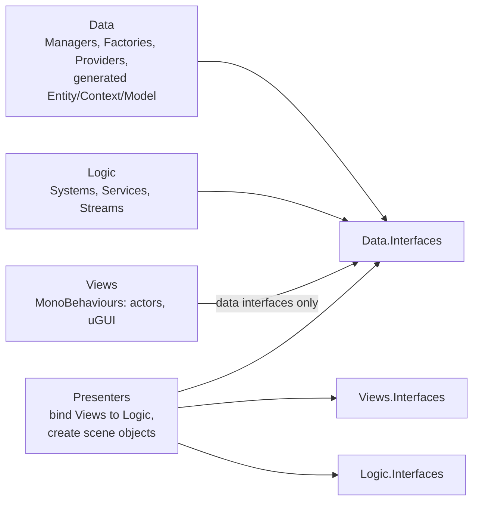
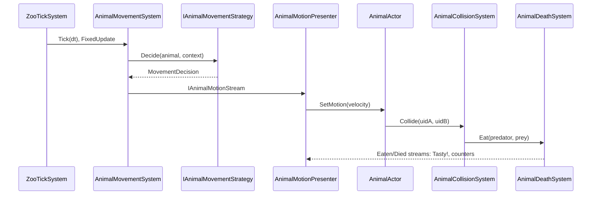
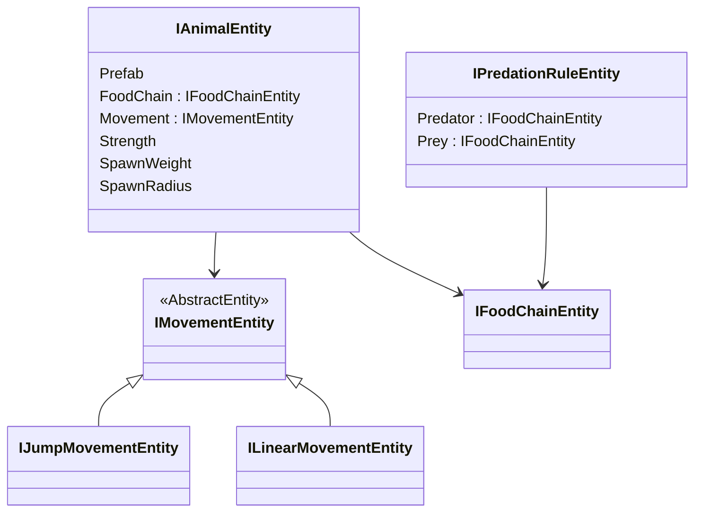

# Zoo World

A test assignment: a 3D zoo viewed from a top-down camera. Every 1–2 seconds a new animal appears and wanders around the field. The frog (prey) jumps a fixed distance, the snake (predator) crawls in a straight line. A predator eats prey on collision; when two predators meet, only one survives. A "Tasty!" label pops up at the collision point, floats up and fades out, and death counters are shown in the top-right corner.

## Running

- Unity **6000.3.22f1**, URP.
- Open `Assets/Scenes/GameScene.unity` and press Play.
- The zoo state is saved (autosave, pause, quit) and restored on the next launch. To start from scratch, delete the `GameSave` file in `Application.persistentDataPath`.
- Tests: Test Runner → EditMode (`ZW.Logic.Tests`, `ZW.Presenters.Tests`).

## Requirements coverage

| Requirement | Where |
|---|---|
| Spawn every 1–2 s, random species | `AnimalSpawnSystem`, `AnimalSpawnPickService` (`SpawnWeight` weights), interval in `zoo_settings` |
| Frog: jumps a fixed distance every X s | `JumpMovementStrategy` + `frog_jump` asset (`Distance`, `Height`, `Interval`) |
| Snake: linear movement | `LinearMovementStrategy` + `snake_crawl` asset (`Speed`) |
| Physics collisions, prey bounce off each other | `Rigidbody` + colliders on actors |
| Predator eats anyone; predator vs predator — one survives | `PredationService` (food chain rules) + `AnimalDuelService` (higher `Strength` wins, random on a tie) |
| "Tasty!" above the predator | `TastyLabelPresenter` + `TastyLabelView` (pooled): spawned at the contact point, floats up and fades out |
| Prey and predator death counters (uGUI, top-right) | `DeathStatsPresenter` → `DeathCounterView` |
| An animal that leaves the screen comes back | `AreaReturnService` (guaranteed turn back into the area) |
| DI, no ECS | Zenject, layered architecture below |

Beyond the assignment: saving and restoring the zoo, object pooling for actors and labels, free-space check on spawn, bouncing off obstacles on the map, a population cap (`MaxAnimals`), 3D models with animations.

## Architecture

The project is built on my JG framework (embedded packages `Packages/com.jamgames.*`): code generation of data types from interfaces, saves, UniRx streams, Zenject configs. The game code is split into four layers, each one an "interfaces + implementation" pair of assemblies with the `ZW` prefix:

| Layer | Responsibility | Rules |
|---|---|---|
| **Data** | Data types and the single place where they change | `Entity` — immutable configs (ScriptableObject → JSON), `Context`/`Model` — persistent state. Models are created only in factories and changed only through managers |
| **Logic** | Simulation rules without any visuals | `Systems` change data through managers, `Services` only compute (CQRS), outgoing events go through `Streams` |
| **Presenters** | Connect logic and presentation | Never change data directly, only call systems. Removing the layer leaves the simulation running |
| **Views** | Presentation only | Simple setters and fact events (position, collision, wall contact) |

Each layer registers in its own DI container (`DataContainer`, `LogicContainer`, `PresentersContainer`, `ViewsContainer`), wired together in `GameInstaller`. Entity repositories and save factories are registered automatically.

### Frame flow

The simulation starts only after the level has loaded (`IZooStartSystem` → `IZooStartedStream`). Until then nothing ticks and restored animals are not spawned.

### Animal data

- **Species** (`IAnimalEntity`) is pure data: prefab, place in the food chain, movement, strength.
- **Movement** is a polymorphic link to a config. Each config type has a `MovementStrategyBase<TConfig>` strategy, selected by the config type (`entity.Movement is TConfig`) — no `switch`, no `enum`.
- **Food chain** is data-driven: roles (`prey`, `predator`) and "who eats whom" rules (`predator_eats_prey`, `predator_eats_predator`). Mutual predation means a duel.

## Scaling to "1000 species"

**A new species with an existing movement type** (a predatory bird, a crawling spider) — no code:
1. A prefab with `AnimalActor`, `Rigidbody` and a collider.
2. An `Animal` asset in `Assets/GameData/Animals`: prefab, food chain, link to a movement asset, strength, spawn weight.
3. `[JG]/Game Data/Create Develop Game Data`.

**A new movement type** (flying, swimming):
1. `IFlyMovementEntity : IMovementEntity` with its parameters → `[JG]/Generator/Generate ALL`.
2. `FlyMovementStrategy : MovementStrategyBase<IFlyMovementEntity>` — only decides velocity and direction.
3. One registration line in `LogicContainer`.

**New relationships** (a bird eats snakes but not frogs) — new `FoodChain` and `PredationRule` assets, no code.

None of these scenarios requires changes to existing systems.

## Framework and code generation

- `Packages/com.jamgames.*` is an embedded copy of the JG v1 framework. Odin Inspector was removed (the repository is public).
- Entities, contexts and models are declared as interfaces in `ZW.Data.Interfaces`. Implementations, EditorEntities (ScriptableObjects) and save models are generated into `Generated/` folders via `[JG]/Generator/Generate ALL`. Generated code is never edited by hand.
- Framework changes made for this assignment:
  - polymorphic entity links (`[AbstractEntity]`, type filter in the inspector);
  - a safe `UpdateSystem`;
  - releasing Addressables on load failures;
  - settings caching.

## Tests

EditMode tests on pure logic (deterministic fakes for randomness and environment):
- **`ZW.Logic.Tests`** — movement strategies, bouncing, returning to the area, spawning, food chain, duel;
- **`ZW.Presenters.Tests`** — object pool.

## Known limitations

- A corrupted save file is not handled separately: if it fails to load, delete it manually.
- Prey bouncing off each other relies on Unity physics: a jumping frog gets an impulse, but a future prey with linear movement would not change course after a collision by itself.
